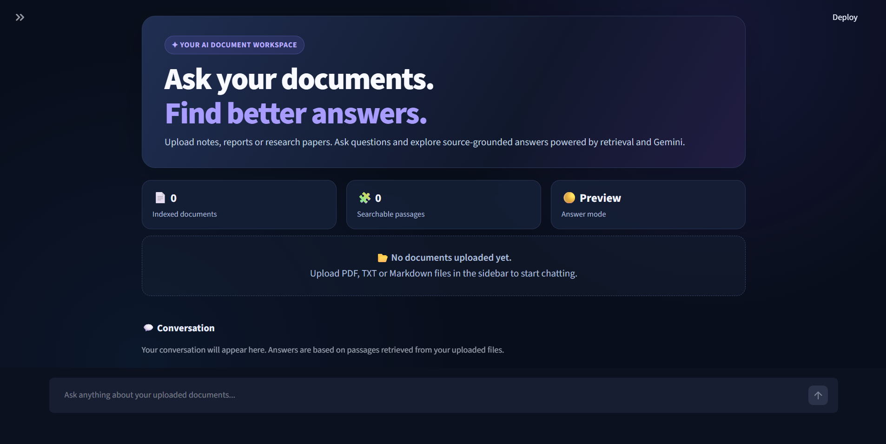
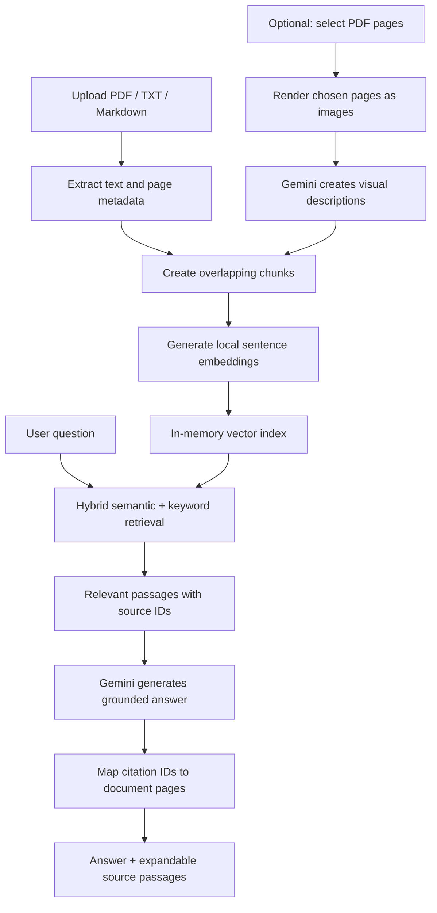

<div align="center">

# 📚 DocuMind AI

### Chat with your documents using Retrieval-Augmented Generation (RAG)

**A document-aware AI assistant built with Python, Streamlit, Sentence Transformers and Google Gemini.**

Upload PDFs, TXT files or Markdown notes, ask questions in natural language, and explore answers with references to the retrieved source passages. Optionally analyze diagrams and tables from selected PDF pages with Gemini vision.


</div>

## 📸 Application preview



*Dark-themed Streamlit workspace. Upload files from the sidebar to start a document-grounded conversation.*

## ✨ Features

- **Multi-document support:** upload PDF, `.txt`, and `.md` files (up to 15 MB per file).
- **Local document processing:** extract PDF text and preserve page numbers with PyMuPDF; split text into overlapping chunks.
- **Semantic search:** create local embeddings with `sentence-transformers/all-MiniLM-L6-v2`.
- **Hybrid retrieval:** combine semantic similarity with BM25-style lexical search and diversity-aware reranking.
- **Gemini-powered answers:** generate responses from retrieved document evidence; preview retrieved passages without an API key.
- **Source-aware citations:** map source IDs to actual filenames and PDF pages and flag invalid citation IDs.
- **Optional visual PDF understanding:** select specific PDF pages for Gemini-powered diagram/table descriptions and add those descriptions to the searchable index.
- **Interactive interface:** modern Streamlit dashboard, chat history in the current session, and expandable source passages.

## 🧠 How it works



**Text RAG:** text extraction, chunking, embeddings and retrieval run locally. The retrieved text passages are sent to Gemini when you request an AI answer.

**Visual RAG (opt-in):** only the PDF pages you explicitly select for analysis are rendered and sent to Gemini for visual descriptions. You can also optionally attach up to two relevant analyzed page images to an answer request.

## 🛠️ Tech stack

| Layer | Technology |
| --- | --- |
| Language | Python |
| Web interface | Streamlit + custom CSS |
| Generative model | Google Gemini via `google-genai` |
| Local embeddings | Sentence Transformers (`all-MiniLM-L6-v2`) |
| Retrieval | Semantic similarity + BM25-style keyword scoring + reranking |
| Vector operations | NumPy (in memory) |
| PDF parsing and rendering | PyMuPDF |
| Configuration | `python-dotenv` |

## 🚀 Getting started

### 1. Clone the repository

```bash
git clone https://github.com/nusaikaj/DocuMind-RAG.git
cd DocuMind-RAG
```

### 2. Set up Python

Python **3.11 or 3.12** is recommended. On Windows, open PowerShell or a terminal inside the repository:

```powershell
py -m venv .venv
.\.venv\Scripts\python.exe -m pip install --upgrade pip
.\.venv\Scripts\python.exe -m pip install -r requirements.txt
```

On macOS/Linux:

```bash
python3 -m venv .venv
source .venv/bin/activate
python -m pip install -r requirements.txt
```

On the first run, Sentence Transformers may download its embedding model. An internet connection is needed for Gemini API calls.

### 3. Configure Gemini (optional for retrieval preview)

1. Get an API key from [Google AI Studio](https://aistudio.google.com/apikey).
2. Copy `.env.example` to `.env` in the project root.
3. Replace the placeholder with your real key:

```dotenv
GEMINI_API_KEY=your_gemini_api_key_here
```

Alternatively, paste the key into the password field in the app's sidebar. You can change the Gemini model name there if your account does not support the suggested default model.

> **Security:** Never commit `.env`, real API keys, private PDFs, or sensitive documents. `.env.example` must contain placeholders only.

### 4. Run the app

On Windows:

```powershell
.\.venv\Scripts\python.exe -m streamlit run app.py
```

On macOS/Linux with the virtual environment activated:

```bash
streamlit run app.py
```

Open **http://localhost:8501** in your browser.

## 💬 Using DocuMind

1. Upload one or more PDF, TXT or Markdown documents in the sidebar.
2. Let the app index the extractable text.
3. Ask a question, such as **“What are the main differences between these architectures?”**
4. Read Gemini's answer and open **View retrieved source passages** to check the evidence.
5. To ask about a PDF diagram, enter its page number under **PDF diagrams & tables**, click **Analyze selected PDF pages**, then ask about that page.

For a simple demo, upload `sample_docs/rag_basics.txt` and ask **“How does RAG retrieve information?”**

## 📁 Project structure

```text
DocuMind-RAG/
├── app.py                  # Streamlit UI and Gemini integration
├── rag_core.py             # Parsing, chunking, retrieval and citation mapping
├── visual_core.py          # Optional PDF page rendering and Gemini vision
├── requirements.txt        # Python dependencies
├── .env.example            # API key configuration template (no secrets)
├── .streamlit/
│   └── config.toml         # Streamlit theme configuration
├── sample_docs/
│   └── rag_basics.txt      # Safe sample document
├── tests/
│   └── test_rag_core.py    # Core unit tests
├── assets/
│   └── documind-dashboard.png
├── LICENSE
└── README.md
```

## 🧪 Run tests

From the project root, after installing dependencies:

**Windows:**

```powershell
.\.venv\Scripts\python.exe -m pip install pytest
.\.venv\Scripts\python.exe -m pytest -q
```

**macOS/Linux (virtual environment activated):**

```bash
python -m pip install pytest
python -m pytest -q
```

## 🔒 Privacy and limitations

- PDF text extraction and embeddings run locally; **retrieved text snippets are shared with Gemini** to generate answers.
- Optional visual analysis **sends selected PDF page images to Gemini** and consumes API quota. Pricing and availability depend on your Google AI project and model.
- Text indexing and visual descriptions are stored **in the current app session**, not a persistent vector database. Uploading files after a restart may require re-indexing.
- Scanned or image-heavy pages need the **optional manual visual analysis**; there is no general automatic OCR pipeline.
- Page-citation mapping verifies that cited IDs correspond to retrieved pages; it **does not guarantee that every generated claim is factually supported**. Always check important answers against the original documents.
- Chat messages appear in the session, but this version does not implement full conversation-aware query rewriting, user accounts or production access controls.

## 🗺️ Roadmap

- [ ] Persistent vector store (e.g. ChromaDB)
- [ ] Retrieval evaluation and reranking improvements
- [ ] More reliable visual extraction and table handling
- [ ] Conversation-aware follow-up questions
- [ ] Cloud deployment and shareable live demo

## 📄 License

Distributed under the **MIT License**. See [LICENSE](LICENSE).

---

<div align="center">

**Built as a practical Data Science / AI portfolio project.**

</div>
